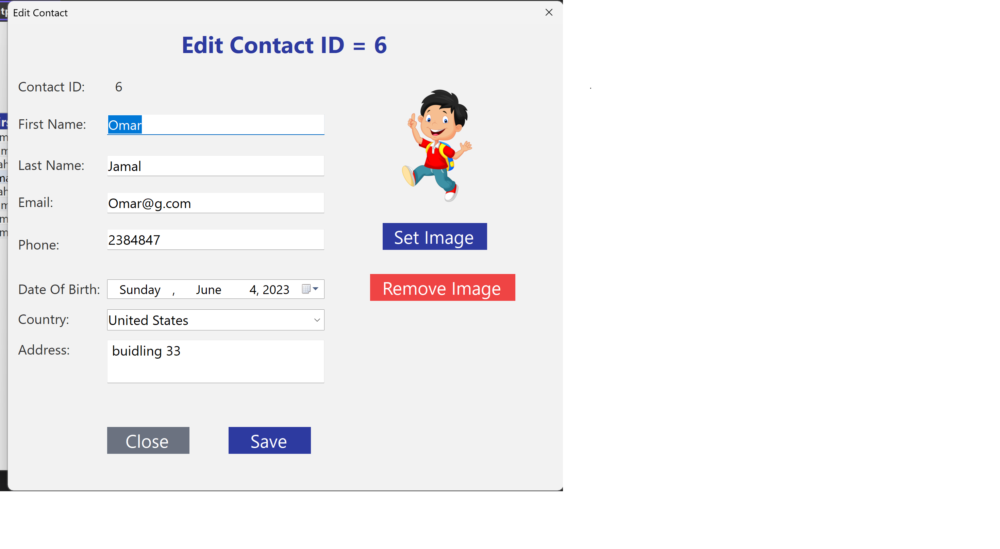

# 📇 Contacts Manager

A desktop contact management application built with **C# Windows Forms** and **SQL Server**, structured using a clean **3-Tier Architecture**.

Add, edit, delete, and instantly search your contacts, each with a photo, country, date of birth, and address.

---

## ✨ Features

- **Full CRUD**: Create, read, update, and delete contacts
- **Live search**: results filter instantly as you type, across first name, last name, email, and phone
- **One form for Add & Edit**: a single form that switches mode automatically
- **Contact photos**: choose a photo per contact, with a default avatar when none is set
- **Country selection**: ComboBox bound to the database (`DisplayMember` / `ValueMember`)
- **Safe confirmations**: Yes/No dialogs default to the safe option before edit or delete
- **Input-safe filtering**: single quotes in the search box are escaped so names like `O'Brien` work

---

## 🏗️ Architecture

The project follows a **3-Tier Architecture** to keep responsibilities separated:

```
┌──────────────────────────┐
│  Presentation Layer (UI) │  Windows Forms: frmMain, frmAddEditContact
└────────────┬─────────────┘
             │
┌────────────▼─────────────┐
│  Business Layer (BLL)    │  clsContact, clsCountry
└────────────┬─────────────┘
             │
┌────────────▼─────────────┐
│  Data Access Layer (DAL) │  SQL Server queries (ADO.NET)
└──────────────────────────┘
```

| Layer | Responsibility |
|---|---|
| **Presentation** | Forms, user input, displaying data |
| **Business** | Contact/Country objects, `Find`, `Save`, `Delete`, `GetAll` |
| **Data Access** | Talking to SQL Server |

---

## 🛠️ Tech Stack

- **Language:** C#
- **UI:** Windows Forms (.NET Framework)
- **Database:** Microsoft SQL Server
- **Data access:** ADO.NET
- **IDE:** Visual Studio

---

## 🚀 Getting Started

### Prerequisites

- Visual Studio 2019 or later (with the **.NET desktop development** workload)
- SQL Server (Express edition is enough)

### Setup

1. **Clone the repository**
   ```bash
   git clone https://github.com/ahmedtamerahmed692-maker/ContactsManager-WinForms.git
   ```
2. **Create the database** in SQL Server and add the `Contacts` and `Countries` tables (see the schema below).
3. **Update the connection string** in the Data Access layer to point to your SQL Server instance.
4. **Open the solution** in Visual Studio, restore packages, and press `F5`.

### Database schema

**Contacts**

| Column | Type | Notes |
|---|---|---|
| ContactID | int | Primary key, identity |
| FirstName | nvarchar | |
| LastName | nvarchar | |
| Email | nvarchar | |
| Phone | nvarchar | |
| Address | nvarchar | |
| DateOfBirth | datetime | |
| CountryID | int | Foreign key → Countries |
| ImagePath | nvarchar | Nullable |

**Countries**

| Column | Type | Notes |
|---|---|---|
| CountryID | int | Primary key |
| CountryName | nvarchar | |

---

## 📖 How It Works

### Add vs. Edit in one form
`frmAddEditContact` receives a contact ID through its constructor. `-1` means *new contact*, any other value means *edit that contact*. The title, fields, and save behavior adapt automatically.

### Images
Only the **file path** of the photo is stored in the database, not the image itself. If the file is missing on the current machine, the app falls back to the default avatar. This keeps the database small and personal photos private.

### Search
The contacts table is loaded once into a `DataTable`. Typing in the search box applies a `DefaultView.RowFilter` with `LIKE` across several columns, so filtering happens in memory with no extra database calls.

---

## 📸 Screenshots




---

## 🗺️ Roadmap

- [ ] Copy photos into an app folder instead of storing external paths
- [ ] Input validation (email format, required fields)
- [ ] Export contacts to Excel / CSV
- [ ] Sorting and paging for large lists

---

## 📚 What I Learned

- Structuring an application with a 3-Tier Architecture
- Binding ComboBox with `DisplayMember` / `ValueMember`
- Passing data between forms and reusing one form for two modes
- In-memory filtering with `DataView.RowFilter`
- Handling `null` values and file paths safely

---

## 👤 Author

**Ahmed Tamer**
GitHub: [@ahmedtamerahmed692-maker](https://github.com/ahmedtamerahmed692-maker)

---

## 📄 License

This project is open source and available under the [MIT License](LICENSE).
